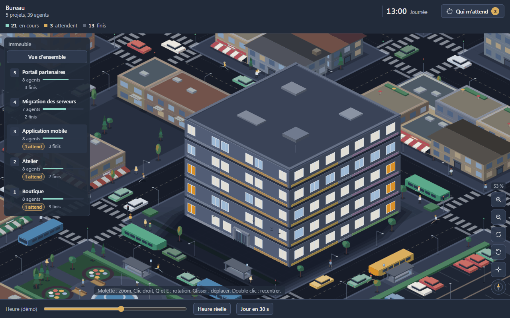

# Bureau

[](https://github.com/nicolabcraft/bureau/actions/workflows/ci.yml)
[](LICENSE)

**Les agents de Boite, vus comme de petits employés dans un immeuble (un étage par projet), avec un chef, des responsables et des agents pour cadrer chaque travail délégué.**



Bureau est un plugin de [Boite](https://github.com/mtsu-dev/boite). Il fait deux choses :

- **Une vue.** Un immeuble en isométrique, un étage par projet Boite, au milieu d'une petite ville vivante. Chaque conversation devient un personnage à son bureau : il tape, lève la main quand il vous attend, va prendre un café quand il a fini, prend l'ascenseur quand il change de projet. Zoom, rotation, éclairage selon l'heure. Une page locale sur `127.0.0.1`, ouverte dans le panneau de Boite, sans aucune ressource distante.
- **Une organisation.** Un chef de projet découpe votre demande en lots et attend votre validation. Des responsables de service lancent chacun leurs agents, relisent chaque rendu et rapportent au format prévu.

## Ce que fait Bureau

- Une zone par équipe, le bureau vitré du chef, une cafétéria, un banc d'attente, une porte d'entrée par où les agents arrivent et repartent.
- Le filtre « Qui m'attend » réunit les agents qui attendent une réponse de votre part, tous fournisseurs confondus.
- Un plan de mission visible, avec un bouton « Valider le plan » : rien ne part sans votre accord.
- Des boutons pour ouvrir la bonne conversation ou arrêter le tour d'un agent.
- Un archivage automatique des conversations inutilisées, avec journal et passage à blanc (Boite 2.0.0-nightly.20261111.1 ou plus récent, voir le [wiki](https://github.com/nicolabcraft/bureau/wiki/Archivage-automatique)).
- Respect de « réduire les animations » du système.

## Installation

1. Dans Boite : Réglages > Plugins > Ajouter depuis une URL git.
2. Coller `https://github.com/nicolabcraft/bureau` et valider.
3. Démarrer le service Bureau dans la même page de réglages.
4. Dans une conversation, lancer `/bureau` pour ouvrir la vue.

## Utilisation rapide

| Geste | Effet |
|---|---|
| `/bureau` | ouvre la vue du bureau dans le panneau |
| `/mission <demande>` | lance une mission : le chef reformule, écrit le plan, attend la validation |
| « Valider le plan » | le bouton de la vue démarre la mission (ou écrire « valide » au chef) |
| « Qui m'attend » | filtre les agents qui attendent une réponse |
| « Arrêter » | arrête le tour d'un agent, après confirmation |

Les commandes pour les agents (`boite bureau-role`, `bureau-plan`, `bureau-mission`, `bureau-rapport`, `bureau-archive`) sont décrites dans le wiki, page [Commandes](https://github.com/nicolabcraft/bureau/wiki/Commandes).

## Documentation

Le [wiki](https://github.com/nicolabcraft/bureau/wiki) couvre tout le détail :

- [Installation](https://github.com/nicolabcraft/bureau/wiki/Installation) et [Premiers pas](https://github.com/nicolabcraft/bureau/wiki/Premiers-pas)
- [La vue du Bureau](https://github.com/nicolabcraft/bureau/wiki/La-vue-du-Bureau)
- [Missions](https://github.com/nicolabcraft/bureau/wiki/Missions) et [Skills](https://github.com/nicolabcraft/bureau/wiki/Skills)
- [Commandes](https://github.com/nicolabcraft/bureau/wiki/Commandes)
- [Archivage automatique](https://github.com/nicolabcraft/bureau/wiki/Archivage-automatique)
- [Configuration](https://github.com/nicolabcraft/bureau/wiki/Configuration) et [Dépannage et FAQ](https://github.com/nicolabcraft/bureau/wiki/Depannage-et-FAQ)
- [Développement](https://github.com/nicolabcraft/bureau/wiki/Developpement) et [Feuille de route](https://github.com/nicolabcraft/bureau/wiki/Feuille-de-route)

Les sources du wiki sont dans [`wiki/`](wiki/). Les spécifications du plugin sont dans [`docs/`](docs/).

## Contribuer

Les tickets et les contributions sont les bienvenus : lire [CONTRIBUTING.md](CONTRIBUTING.md), puis ouvrir un [ticket](https://github.com/nicolabcraft/bureau/issues/new/choose) ou une pull request. Pour une faille de sécurité, voir [SECURITY.md](SECURITY.md).

Pour travailler sur le code :

```sh
bun install
bun run check      # tsc
bun test           # tests du service, du registre et des commandes
bun run pack       # bureau.js + skills et sha256 dans boite-plugin.json
bun run demo       # la vue contre un faux Boite, sans installer le plugin
```

Code et commentaires en anglais ; README, wiki, interface, sorties des commandes, skills et commits en français (`type: résumé`). Contrat de données unique : `src/model.ts`. Aucune ressource distante dans la vue.

## Licence

[MIT](LICENSE).
