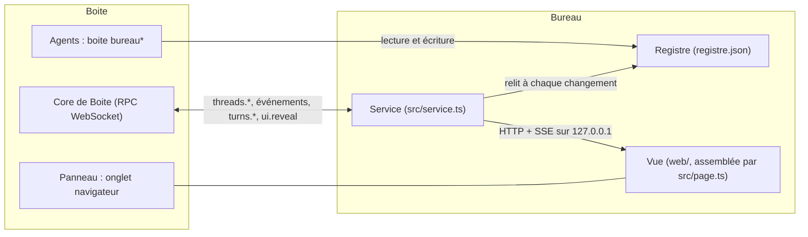

# Développement

Bureau est écrit en TypeScript, exécuté par Bun. Ce qui suit vient du code du dépôt.

## Mise en route

```sh
bun install
bun run check          # tsc --noEmit
bun test               # tests du service, du registre, de l'état, des commandes, de l'archivage, du manifeste
bun run pack           # bureau.js + skills et sha256 dans boite-plugin.json
bun run check:manifest # contrôle boite-plugin.json contre les règles du schema 2
bun run demo           # le vrai service contre un faux core de Boite
```

`boite plugin dev .` charge le plugin dans Boite depuis un dossier local. À lancer depuis un terminal, pas depuis un agent.

## Règles du projet

- Code et commentaires en anglais ; README, wiki, interface, sorties des commandes, skills et commits en français (`type: résumé`, par exemple `feat:`, `fix:`, `docs:`, `chore:`).
- Contrat de données unique : `src/model.ts`. La vue ne fait que dessiner un `OfficeState`.
- Bureau parle à Boite seulement par le RPC du core avec son jeton de plugin (`threads.read`, `threads.write`, `ui.reveal`).
- Aucune ressource distante dans la vue. Pas de tiret cadratin ni demi-cadratin dans les textes visibles, pas d'emoji dans l'interface.
- `boite-plugin.json` : `commands`, `prompt`, `slashCommands` écrits à la main ; `skills` et `artifacts` écrits par `bun run pack`.

## Architecture



| Fichier | Rôle |
|---|---|
| `src/main.ts` | point d'entrée de `bureau.js`. Sans argument : le service ; avec un argument : une commande `boite <nom>` |
| `src/service.ts` | connecte le core, garde fils et registre en mémoire, sert la vue et l'API sur `127.0.0.1`, pousse un état complet à chaque changement, fait le passage d'archivage toutes les 10 minutes |
| `src/rpc.ts` | client JSON-RPC 2.0 vers le core (WebSocket `<core>/rpc`, protocole 2), avec reconnexion |
| `src/core-types.ts` | la part des contrats de Boite que Bureau lit (`ThreadRow`, `ProjectRow`, méthodes, événements) |
| `src/state.ts` | construit l'`OfficeState` à partir des fils, des projets et du registre. Pur : aucune horloge, aucune E/S |
| `src/registry.ts` | registre `registre.json` : rôles, missions, rapports, messages en attente ; écriture atomique sous verrou |
| `src/commands.ts` | les six commandes `boite bureau*` |
| `src/archive.ts` | règles d'archivage (`decideArchive`, pur), passage, réglages, journal |
| `src/model.ts` | le contrat de données entre le service et la vue |
| `src/page.ts` | assemble la page de la vue : `web/index.html`, les modules de `web/immeuble/` dans une seule portée, puis `web/app.js` ; figée dans `bureau.js` au paquetage, relue à chaque requête en démo |
| `web/index.html` | balisage et styles de la vue |
| `web/app.js` | liaison avec le service : état reçu, fiche, listes, plan, boutons |
| `web/immeuble/` | la scène isométrique, en modules : `noyau`, `moteur`, `controles`, `boucle` (caméra, rendu), `etages`, `chantier` (immeuble), `agents`, `ville`, `lumiere`, `plan` (plan pur de l'immeuble), `donnees` (état vers scène), `hud` (panneau, bulle). Contrat : `docs/vue-immeuble.md` |
| `skills/` | sources des trois skills |
| `scripts/` | `pack.ts`, `check-manifest.ts`, `demo.ts`, `mesure-vue.js` (mesure de fluidité de la vue) |
| `test/` | tests Bun et aides (`helpers.ts` : faux core, dossiers temporaires) |

## Contrat de données

Défini dans `src/model.ts`. Le service construit un `OfficeState` ; la vue le dessine.

```
OfficeState
  projects[]         projets de Boite { id, name }, ordre de projects.list, sans leur chemin
  teams[]            équipes, activité la plus récente d'abord ; fils archivés exclus
    id, title, projectId, projectName, lastActivity
    agents[]         la racine d'abord, puis en largeur
      id             id du fil Boite
      role           chef | manager | agent
      roleSource     declared | guessed
      service        service, ou null
      parentId       fil au-dessus dans l'équipe, ou null
      model, provider
      state          running | queued | waiting | idle | done | error
      waitingFor     permission | question | null
      since          début de la demande en cours, ou null
      report         dernier rapport { text, at }, ou null
      files[]        fichiers attribués
      createdAt      création du fil
    mission          Mission, ou null
      status         proposed | validated | done
      budget         { maxAgents, models[] }
      lots[]         { id, title, service, model, agentId, state: todo | running | done }
      validatedVia   bureau | chat | null
  waitingCount       agents en attente de l'utilisateur, toutes équipes
  core               connected | connecting | disconnected
  generatedAt
  archives[]         conversations archivées dans la dernière journée
```

### API HTTP locale

| Route | Effet |
|---|---|
| `GET /` | la vue |
| `GET /api/state` | l'`OfficeState` |
| `GET /api/events` | flux `text/event-stream`, un `event: state` avec l'état complet à chaque changement |
| `POST /api/reveal` | `{ "threadId": "..." }` : montre cette conversation dans Boite (`ui.reveal`) |
| `POST /api/stop` | `{ "threadId": "..." }` : arrête son tour (`turns.stop`) |
| `POST /api/missions/:id/validate` | marque le plan validé et prévient le chef (`turns.start`) |

Tout POST exige l'en-tête `X-Bureau: 1` et, si présent, un `Origin` égal à celui de la page. L'en-tête `Host` doit être l'adresse liée `127.0.0.1:<port>`.

### État d'un personnage

Dérivé du `status` du fil Boite :

- `running` donne running, `queued` donne queued, `error` donne error ;
- `waiting` donne waiting (permission), et `openQuestions > 0` donne waiting (question), prioritaire sur running ;
- `idle` : une racine est idle, un enfant (qui a un `parentThreadId`) est done ;
- `idle` d'un responsable rattaché par `--chef` (donc sans `parentThreadId`) : done seulement s'il a déposé son rapport (et que son fil n'a pas bougé plus de deux minutes après), ou si une mission de son chef est `done` ; sinon idle. S'il retravaille, l'état courant prime.

Lieu à l'écran : l'étage du projet de l'équipe ; idle et done vont à la cafétéria, queued au banc de l'entrée à l'arrivée, les autres au bureau.

### Registre

```json
{
  "version": 1,
  "roles": { "<threadId>": { "role": "manager", "service": "Développement", "files": [], "at": 0, "chefId": "<facultatif>" } },
  "missions": { "<missionId>": {} },
  "reports": { "<threadId>": { "text": "...", "at": 0 } },
  "pendingNotices": [ { "threadId": "...", "prompt": "...", "at": 0 } ]
}
```

Arbre de l'équipe : le fil au-dessus de chaque fil est son `parentThreadId`, sauf pour un fil avec un lien `chefId`, qui se place sous ce chef. Un lien est ignoré si le chef n'existe plus, est archivé, est le fil lui-même ou fermerait une boucle ; si deux liens se contredisent, le plus ancien reste.

## Tests

```sh
bun test
```

248 tests dans 10 fichiers, sans accès à un vrai Boite :

| Fichier | Couvre |
|---|---|
| `test/state.test.ts` | construction de l'`OfficeState`, états, arbre d'équipe, projets |
| `test/plan.test.ts` | plan de l'immeuble : étages, ordre, zones, places, débordements |
| `test/page.test.ts` | page assemblée : modules présents, scripts valides, pas de nom déclaré deux fois, aucune ressource distante |
| `test/registry.test.ts` | registre, verrou, missions, lots |
| `test/commands.test.ts` | les commandes, leurs sorties et codes de sortie |
| `test/service.test.ts` | le service, l'API HTTP, le flux d'événements |
| `test/archive.test.ts` | règles d'archivage, réglages, journal |
| `test/manifest.test.ts` | validité de `boite-plugin.json` |
| `test/github.test.ts` | fichiers du dépôt GitHub (CI, modèles) |
| `test/release-notes.test.ts` | notes d'une version : section du journal et tuto d'installation |

`test/helpers.ts` fournit un faux core de Boite (`fakeCore`), des fils de test et des dossiers temporaires.

## Démo

```sh
bun run demo
```

Lance le vrai service contre un faux core qui tient plusieurs projets réalistes et les fait évoluer : arrivées, départs, attentes, mission proposée puis validée, agent qui change de projet, nouveau projet vers 30 s (un étage se construit). `BUREAU_DEMO=gros` donne 5 projets et 40 agents. Rien ne s'ouvre tout seul : la commande affiche l'adresse (`http://127.0.0.1:47318/` par défaut, `BUREAU_PORT` pour en changer). Dans Boite : `boite browse <adresse>`. La page est relue à chaque chargement : une modification de `web/` se voit sans relancer la démo. `?demo=1` dans l'adresse affiche le réglage de l'heure.

### Mesurer la fluidité

Avec `BUREAU_DEMO=gros bun run demo`, ouvrir la page avec `?demo=1`, injecter `scripts/mesure-vue.js` dans la page (console du navigateur, ou `boite browser eval`), puis `__mesure.start({passes: 3})` et `__mesure.get()` : images par seconde, pire image, temps de calcul et mémoire par image, en glisser, zoom, rotation et sur un étage ouvert, de jour et de nuit. Budget : au moins 60 images par seconde (`docs/vue-immeuble.md`).

## Livrer

`main` est protégée : on y arrive par une pull request dont le titre suit `type: résumé` et dont la CI passe ; ni force-push ni suppression.

### Intégration continue

| Workflow | Quand | Fait |
|---|---|---|
| `ci` | push sur `main`, chaque PR | types, tests, manifeste, `bun run pack` (le manifeste commité doit être celui que pack produit), wiki et README, tirets ; garde `bureau.js` du commit comme artefact 14 jours |
| `codeql` | push sur `main`, chaque PR, chaque lundi | analyse de sécurité du code JavaScript et TypeScript |
| `titre de la PR` | chaque PR | format `type: résumé` |
| `wiki` | push sur `main` qui touche `wiki/` | publie `wiki/` dans le wiki GitHub |
| `release` | tag `v*` | refait la CI, construit `bureau.js`, crée la version GitHub et contrôle le fichier publié |

### Publier une version

1. Sur une branche : monter `version` dans `package.json` et `boite-plugin.json`, et l'adresse `artifacts.any.url` du manifeste (`.../releases/download/vX.Y.Z/bureau.js`).
2. Ajouter la section `## X.Y.Z` en tête de `CHANGELOG.md`.
3. `bun run pack`, puis `bun run check`, `bun test` ; commiter `boite-plugin.json` (somme SHA-256 à jour).
4. Pull request, CI verte, fusion dans `main`.
5. Sur `main` à jour : `git tag vX.Y.Z` puis `git push origin vX.Y.Z`.

Le workflow `release` vérifie que le tag, `package.json` et le manifeste concordent, reconstruit `bureau.js` (même commit, même somme), puis crée la version avec `bureau.js`, `boite-plugin.json` et `SHA256SUMS`. Ses notes sont la section du journal suivie du tuto d'installation complet (`.github/release/installation.md`, assemblé par `scripts/release-notes.ts`). Enfin il télécharge `bureau.js` à l'adresse du manifeste et compare la somme, comme Boite le fera.

## Contribuer

Voir [CONTRIBUTING.md](https://github.com/nicolabcraft/bureau/blob/main/CONTRIBUTING.md) à la racine du dépôt.
