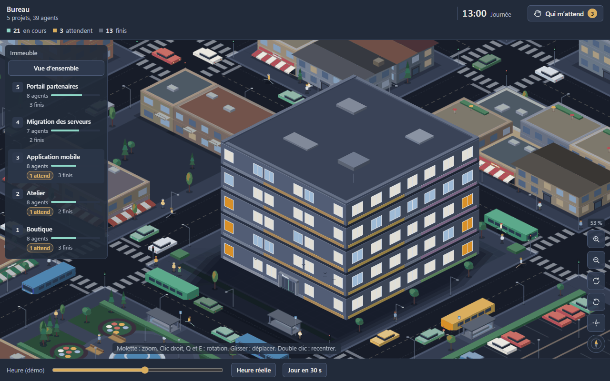
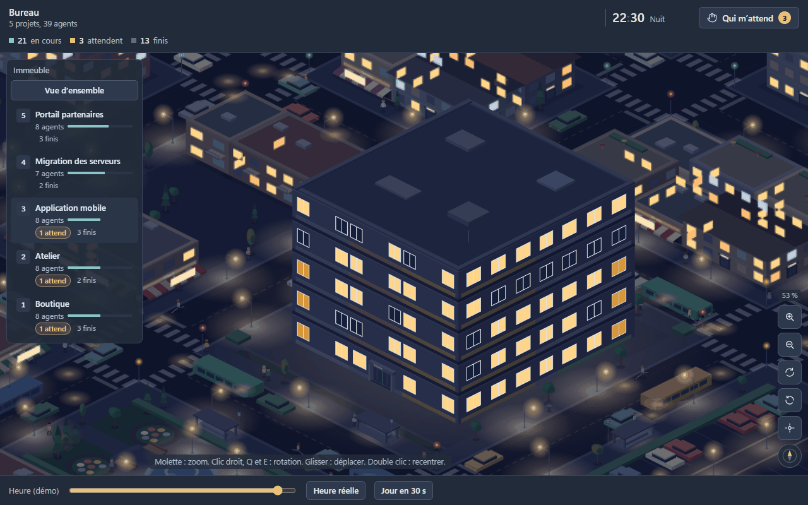
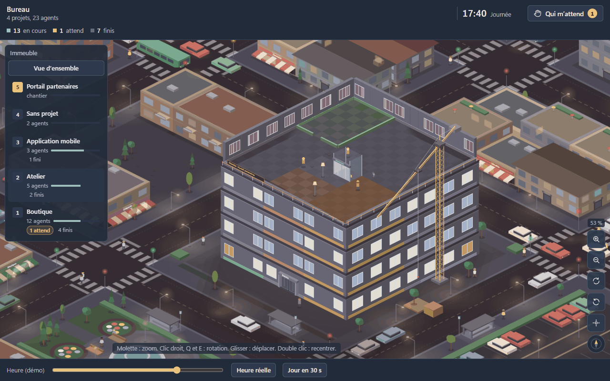
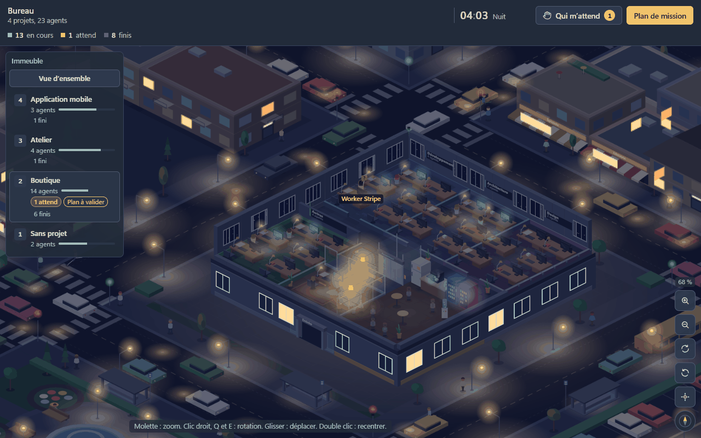
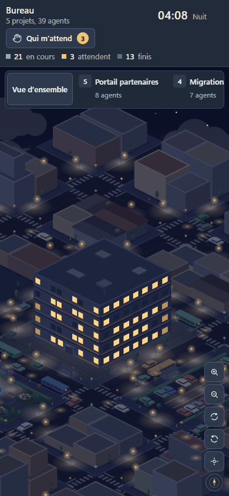
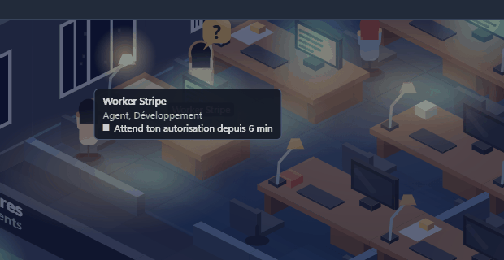

# La vue du Bureau

La vue est une page locale servie par le service sur `127.0.0.1`, ouverte dans l'onglet navigateur du panneau de Boite (`/bureau`). Elle ne fait que dessiner l'état que le service lui envoie, en direct. Aucune ressource distante n'est chargée.

## L'immeuble

- Un immeuble vu en isométrique, au milieu d'une petite ville. **Un étage par projet Boite** qui a au moins une conversation en cours ; les conversations sans projet occupent l'étage « Sans projet ».
- Un nouveau projet ajoute un étage au sommet : grue, dalle, murs, mobilier, puis ses agents arrivent par la porte d'entrée et prennent l'ascenseur. L'ordre des étages est gardé d'une visite à l'autre.
- Vu de l'extérieur, un étage est fermé : ses fenêtres s'allument selon le nombre d'agents présents, et une ou deux fenêtres ambre pulsent quand un agent attend une réponse. Un projet qui n'a plus de conversation pendant 20 secondes perd son étage : ses agents sortent, l'étage est démoli (fenêtres éteintes, grue, murs et dalle retirés) et les étages du dessus descendent. Le rez-de-chaussée, qui porte l'entrée, reste en place, vide.
- Cliquer un étage (sur la façade ou dans le panneau « Immeuble ») l'ouvre : les étages du dessus s'effacent et on voit l'intérieur. « Vue d'ensemble » ou Échap referment tout.
- L'éclairage suit l'heure réelle : matin, journée, soir, nuit avec lampes de bureau, lampadaires et vitrines.

## Un étage

- Le chef de l'équipe la plus récente occupe le bureau vitré, avec le nom du projet sur sa plaque.
- Une zone par service (sol de couleur, cloisons basses, plaque avec le nom du service), son responsable en tête. Les autres équipes du projet ont chacune leur zone ; les conversations seules partagent la zone « Conversations ». Quand il y a trop de zones, les plus petites se regroupent dans « Autres ».
- Une nouvelle équipe ou mission sur un étage existant fait construire sa zone : barrière, sol, cloisons, puis les bureaux un par un.
- Chaque étage a sa cafétéria et l'ascenseur. Le rez-de-chaussée a aussi la porte d'entrée et le banc d'attente.
- Un agent qui change de projet prend l'ascenseur jusqu'à son nouvel étage. Un agent dont la conversation est archivée descend, sort par la porte d'entrée, et un message le signale.

## Les états d'un agent

La posture du personnage dit l'état de son fil Boite.

| Libellé de la fiche | Sur la scène | Sens |
|---|---|---|
| En cours | assis, écran allumé, il tape | un tour tourne |
| Attend ta réponse | main levée, bulle « ? », entouré d'ambre, nom affiché | une permission ou une question attend l'utilisateur |
| En file d'attente | banc de l'entrée à son arrivée, puis sablier à son bureau | le tour attend un créneau |
| En pause | à la cafétéria, gobelet en main | conversation racine au repos |
| Fini | rend son dossier à son responsable, puis cafétéria, grisé | enfant au repos, ou responsable qui a déposé son rapport |
| En erreur | bulle rouge | le fil est en erreur |
| Arrêté | inchangée | tour arrêté depuis la vue (affichage local) |

Règles complètes de dérivation : voir [Développement](Developpement), section « État d'un personnage ».

## Le panneau Immeuble

En haut à gauche, un bouton par étage, du haut vers le bas : nom du projet, nombre d'agents, jauge, « N attend » en ambre, « Plan à valider » quand une mission attend la validation, « chantier » pendant la construction. Sur un écran étroit, le panneau devient une bande d'étages.

## Les gestes

| Geste | Effet |
|---|---|
| Bouton « ? » des outils | légende : ce que disent les postures, les fenêtres ambre, la grue et l'ascenseur |
| Survoler un agent | bulle : nom, rôle et service, état et depuis quand, lot de mission |
| Cliquer un agent | ouvre sa fiche : portrait, état, service, supérieur, modèle, fichiers attribués, dernier rapport |
| Ouvrir la conversation | amène Boite sur la conversation de l'agent |
| Répondre | même chose : la réponse à une permission ou à une question se fait dans Boite |
| Arrêter | arrête le tour de l'agent, après une confirmation |
| Qui m'attend | liste les agents qui attendent une réponse et atténue les autres ; un clic ouvre l'étage et la fiche de l'agent |
| Plan de mission | le plan de l'étage ouvert, sinon le plus récent à valider ; « Valider le plan » tant qu'il est proposé |
| Molette, pincement, + et - | zoom |
| Glisser, flèches | déplacer |
| Clic droit glissé, Q et E, deux doigts | tourner |
| Double clic, 0 | recentrer |
| PageHaut, PageBas | étage du dessus, du dessous |
| Échap | ferme la fiche, puis revient à la vue d'ensemble |

## Bandeau de connexion

- « Connexion à Boite en cours. » : le service se connecte au core de Boite.
- « Bureau a perdu la connexion avec Boite. Ce que tu vois peut être ancien. » : voir [Dépannage et FAQ](Depannage-et-FAQ).

## Accessibilité

Avec « réduire les animations » activé dans le système, plus personne ne marche : chacun apparaît directement à sa place, les étages et les zones apparaissent sans chantier, et le zoom, la rotation et le changement d'étage sont instantanés.

## Fluidité

Mesurée avec 5 étages et 40 agents : au moins 60 images par seconde en glisser, zoom et rotation, de jour comme de nuit. Le décor fixe est dessiné une fois puis réutilisé, les étages fermés ne dessinent que leur façade, et le niveau de détail baisse quand on dézoome. Voir [Développement](Developpement) pour la mesure.

## Ce que la vue montre ou non

- Équipes montrées : celles qui ont eu une activité dans les 24 dernières heures, 30 au plus.
- Ignorés : fils archivés, chats d'équipe Boite, salons, conversations incognito.
- L'heure se règle à la main seulement en démonstration (`?demo=1` dans l'adresse).
