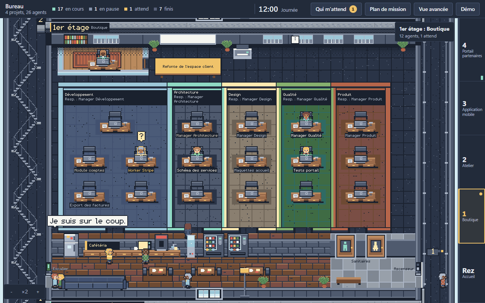
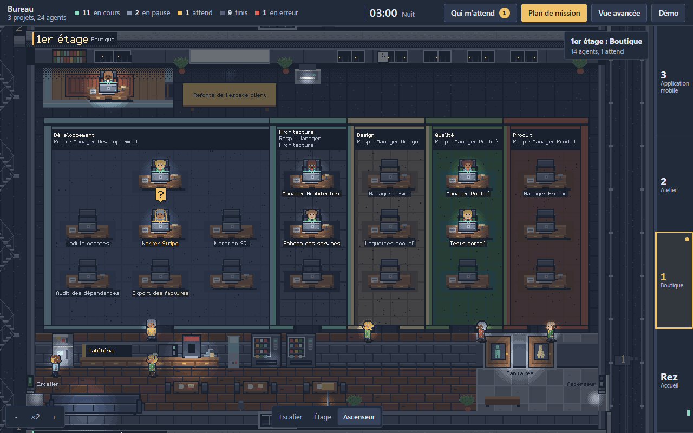
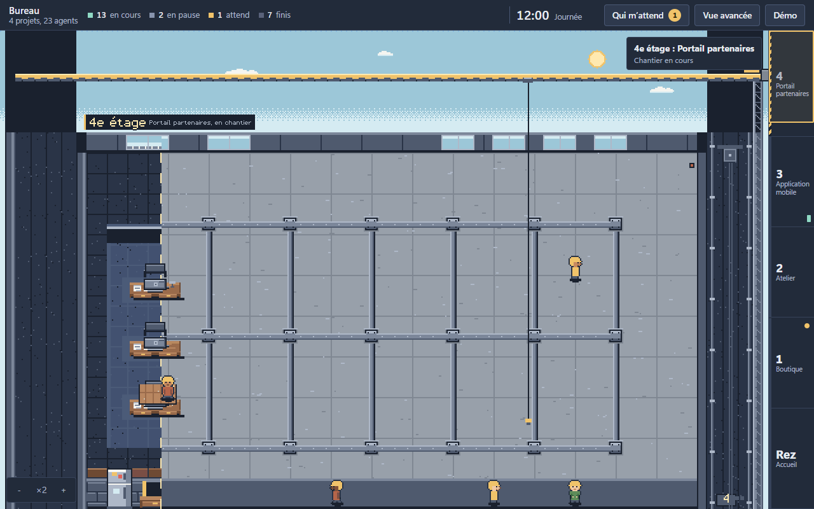
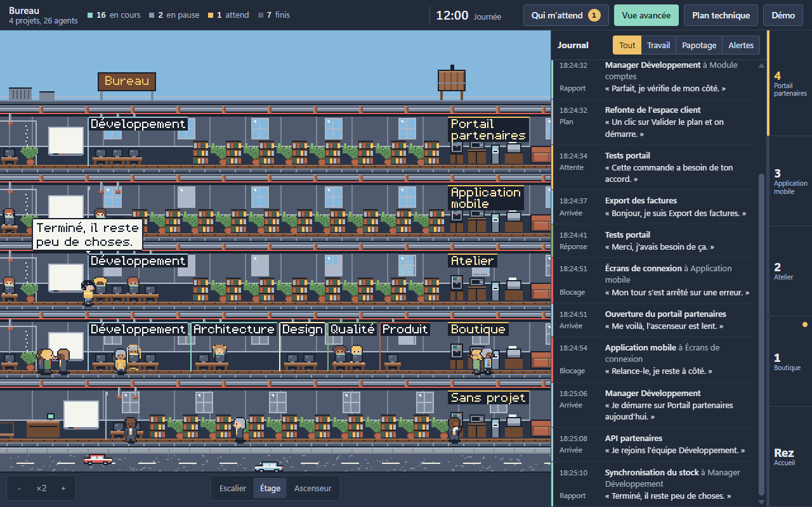
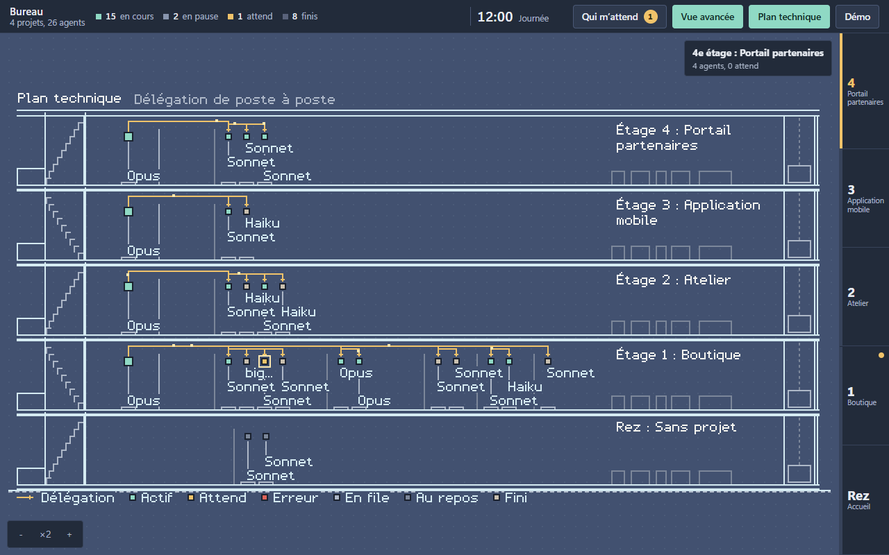
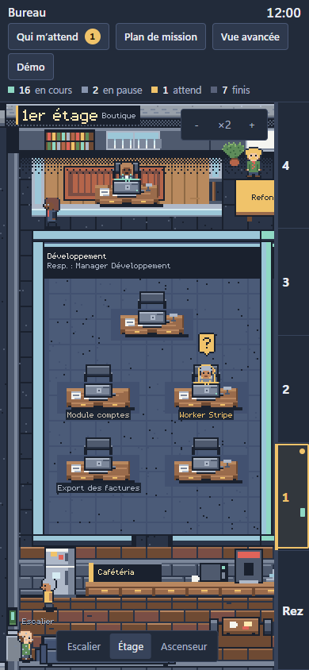

# La vue du Bureau

La vue est une page locale servie par le service sur `127.0.0.1`, ouverte dans l'onglet navigateur du panneau de Boite (`/bureau`). Elle ne fait que dessiner l'état que le service lui envoie, en direct. Aucune ressource distante n'est chargée.

La vue est en pixel art, vue de dessus : les étages sont empilés, chacun est un plan. La vue isométrique précédente n'est plus servie.

## L'immeuble

- **Un étage par projet Boite** qui a au moins une conversation en cours ; les conversations sans projet occupent le rez-de-chaussée, « Sans projet », qui reste toujours en bas.
- Chaque étage a son escalier, son ascenseur, sa cafétéria et ses sanitaires. Le rez-de-chaussée a aussi la porte d'entrée et le banc d'attente.
- Un agent qui change de projet prend l'ascenseur jusqu'à son nouvel étage. Un agent dont la conversation est archivée descend et sort par la porte d'entrée, et un message le signale.
- Un nouveau projet fait construire son étage : grue au sommet, dalle, murs, mobilier. Une nouvelle équipe fait construire sa zone.
- Un projet sans conversation pendant 20 secondes perd son étage : ses agents sortent, l'étage est démoli (chantier à l'envers) et les étages du dessus descendent.
- L'éclairage suit l'heure réelle : jour, soir, nuit avec lampes de bureau et lumière des fenêtres.

## Un étage

- Une zone par service (sol de couleur, plaque avec le nom du service), son responsable en tête. Les autres équipes du projet ont chacune leur zone ; les conversations seules ont la zone « Conversations ».
- Chaque agent est un personnage à son poste. Son état se lit sur la scène (tableau ci-dessous).
- Les agents qui se parlent ont une bulle. Un clic sur la bulle ouvre la boîte de dialogue avec les deux portraits, et « Ouvrir la conversation » amène Boite sur le fil.

## Les états d'un agent

| Libellé de la fiche | Sur la scène |
|---|---|
| En cours | assis à son poste, écran allumé, il tape |
| Attend ta réponse | main levée, bulle « ? » ambre, contour ambre, nom affiché en permanence |
| En file d'attente | banc de l'entrée à son arrivée, puis à son poste avec un sablier |
| En pause | une action de vie de bureau : café, imprimante, plantes, fenêtre |
| Fini | apporte son dossier à son responsable, puis pause, légèrement grisé |
| En erreur | assis, bulle rouge ; il appelle son responsable, qui vient voir |

Règles complètes de dérivation : voir [Développement](Developpement), section « État d'un personnage ».

## Les gestes

| Geste | Effet |
|---|---|
| Molette | fait défiler l'immeuble ; Maj + molette : côté |
| Ctrl + molette, pincement | zoom, par crans entiers |
| Glisser | déplace la vue |
| Survoler un agent | bulle : nom, rôle et service, état et depuis quand, lot de mission |
| Cliquer un agent | ouvre sa fiche : portrait, état, service, supérieur, modèle, fichiers attribués, dernier rapport |
| Cliquer une bulle | ouvre la boîte de dialogue des deux agents |
| Ouvrir la conversation | amène Boite sur la conversation de l'agent |
| Répondre | même chose : la réponse à une permission ou à une question se fait dans Boite |
| Arrêter | arrête le tour de l'agent, après une confirmation |
| Qui m'attend | liste les agents qui attendent une réponse et atténue les autres ; un clic ouvre l'étage et la fiche de l'agent |
| Plan de mission | le plan de l'étage ouvert, sinon le plus récent à valider ; « Valider le plan » tant qu'il est proposé |

### Étages et clavier

La barre d'étages est à droite, un bouton par étage, du haut vers le bas, avec `-`, `x2` et `+` pour le zoom. Sur un téléphone, la barre devient une bande en bas : Escalier, Étage, Ascenseur.

| Touche | Effet |
|---|---|
| PageHaut, flèche haut | étage du dessus |
| PageBas, flèche bas | étage du dessous |
| Début (Home) | dernier étage, le plus haut |
| Fin (End) | rez-de-chaussée |
| Flèches gauche et droite | déplace la vue sur le côté |
| `+` et `-` | zoom |
| `0` | recentre l'étage (ajuste le zoom) |
| Échap | ferme la fiche, puis revient à la vue d'ensemble |

## Vue avancée

Le bouton « Vue avancée » affiche une coupe de l'immeuble : chaque étage est une bande, avec ses salles et ses postes de gauche à droite, la cage de l'ascenseur à droite et la rue en bas.

- Les délégations et les rapports partent en capsules : de l'agent qui délègue vers celui qui reçoit, d'un étage à l'autre s'il le faut.
- Le **journal** à droite classe les événements en quatre onglets : Tout, Travail (délégations, rapports, plans, arrivées, départs), Papotage (les échanges entre agents) et Alertes (bloqué, attend une réponse).
- Survoler une ligne du journal met en évidence ses deux agents ; un clic sur la ligne amène la vue sur l'agent.

## Plan technique

Le bouton « Plan technique », visible dans la vue avancée, dessine l'arbre de délégation de bureau en bureau, avec le modèle écrit sous chaque bureau. Les étiquettes ne se recouvrent pas.

## En-tête et messages

- « Qui m'attend » et le bouton « Plan de mission » sont dans l'en-tête, avec leur compteur.
- Les messages courts (validation, erreur, archivage) apparaissent en haut de la scène, puis disparaissent.

## Bandeau de connexion

- « Connexion à Boite en cours. » : le service se connecte au core de Boite.
- « Bureau a perdu la connexion avec Boite. Ce que tu vois peut être ancien. » : voir [Dépannage et FAQ](Depannage-et-FAQ).

## Accessibilité

Avec « réduire les animations » activé dans le système, le texte des bulles s'affiche d'un coup, et le changement d'étage et le zoom sont instantanés.

## Fluidité

Mesurée avec `bun run demo` en mode gros (5 projets, 40 agents), fenêtre 1280 x 800 : au moins 60 images par seconde en vue d'étage, de jour comme de nuit, en défilement d'un étage au suivant, en vue avancée et sur le plan technique. Le décor fixe de chaque étage est dessiné hors écran puis réutilisé. Voir [Développement](Developpement) pour le détail et la méthode de mesure, et `docs/vue-pixel.md`, section 3, pour le tableau.

## Ce que la vue montre ou non

- Équipes montrées : celles qui ont eu une activité dans les 24 dernières heures, 30 au plus.
- Ignorés : fils archivés, chats d'équipe Boite, salons, conversations incognito.
- L'heure se règle à la main seulement en démonstration (`?demo=1` dans l'adresse).
