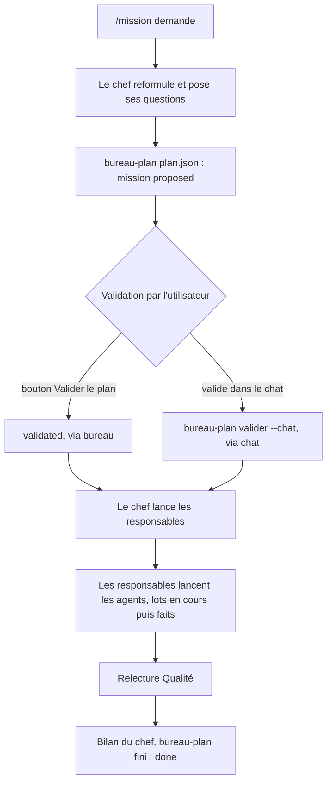

# Missions

Une mission est un travail découpé en lots, avec un plan que l'utilisateur valide avant que quoi que ce soit parte.

## Trois étages

| Rôle | Fait | Ne fait pas |
|---|---|---|
| Chef de projet | écrit le plan, lance les responsables, rend le bilan | ne code pas, ne valide jamais son plan |
| Manager Produit | critères d'acceptation, questions pour l'utilisateur | ne choisit pas la technique |
| Manager Architecture | découpe technique, fichiers par agent | n'écrit pas le code des agents |
| Manager Développement | briefs de 30 lignes, relecture de chaque rendu | ne touche pas aux fichiers de ses agents |
| Manager Design | 3 options visuelles montrées avant tout code | n'applique rien sans le choix de l'utilisateur |
| Manager Qualité | tests, relecture indépendante, sécurité | ne corrige pas, renvoie au manager concerné |
| Agent | un lot, ses fichiers, rapport au format fixe | pas de commit ni de suppression sans ordre |

Le chef ne crée que les responsables utiles : une correction simple demande Développement et Qualité, une refonte visuelle ajoute Design, un besoin flou ajoute Produit, un découpage lourd ajoute Architecture. Il n'y a pas de scrum master.

### Pourquoi deux mécanismes de lancement

Boite n'autorise qu'un étage de délégation : un sous-agent lancé par `boite delegate spawn` ne peut pas en lancer d'autres. Donc :

- le chef lance chaque responsable avec `boite thread new`, une conversation indépendante qui peut elle-même lancer des agents ;
- le responsable se rattache au chef avec `boite bureau-role manager --service <nom> --chef <id du chef>` (l'id du chef est la ligne `thread:` de `boite where`) ;
- le responsable lance ses agents avec `boite delegate spawn` et les déclare avec `boite bureau-role agent --service <nom> --thread <id>`.

La vue et `boite bureau-mission` montrent alors l'équipe entière sous le chef, quel que soit le fil qui la regarde. Vérifications de `--chef` : le fil et le chef existent, le fil n'est pas son propre chef, le rattachement ne ferme pas de boucle.

Sans rôle déclaré, la vue devine : racine = chef, profondeur 1 = manager s'il a des enfants (sinon agent), profondeur 2 et plus = agent.

## Déroulé d'une mission



## Le plan

Le chef écrit un fichier `plan.json` et le dépose avec `boite bureau-plan plan.json`.

```json
{
  "title": "Refonte de l'espace client",
  "summary": "Ce que l'utilisateur veut, en 2 à 4 lignes.",
  "budget": { "maxAgents": 8, "models": ["claude/claude-sonnet-5-5", "claude/claude-haiku-5-5"] },
  "lots": [
    { "id": "L1", "title": "Webhook de paiement et ses tests", "service": "Développement", "model": "claude/claude-sonnet-5-5" },
    { "id": "L2", "title": "Relecture sécurité", "service": "Qualité", "model": "claude/claude-opus-5-5" }
  ]
}
```

Règles :

- 1 à 40 lots ; `id` unique, 1 à 20 caractères parmi `A-Z a-z 0-9 _ -`.
- `service` : Produit, Architecture, Développement, Design ou Qualité (texte libre accepté).
- `model` : le modèle le moins cher qui suffit pour ce lot.
- `budget.maxAgents` est facultatif ; `budget.models` liste les modèles que les lots peuvent utiliser.
- Un second plan `proposed` pour le même chef est refusé, sauf avec `--remplacer`.

Le budget (nombre d'agents, modèles) est approuvé avec le plan. Le dépasser demande une nouvelle validation.

## Les états

| Objet | États |
|---|---|
| Mission | `proposed` (attend l'utilisateur), `validated` (les lots peuvent partir), `done` (le chef a rendu son bilan) |
| Lot | `todo` (À faire), `running` (En cours), `done` (Fait) |

## La validation

- Dans la vue : « Valider le plan ». Le service marque la mission `validated` (via `bureau`) et envoie au chef le message `Le plan <id> a été validé dans Bureau. Lance les lots.`. Si le chef est occupé, le service réessaie quand son fil repasse au repos.
- Dans le chat : l'utilisateur écrit « valide » au chef, qui lance `boite bureau-plan valider <id> --chat` (via `chat`). Un message ambigu, une question ou un silence ne valident rien.
- Le chef ne valide jamais son plan de lui-même.

## Les lots

Le responsable marque un lot en cours quand il lance l'agent, et fait quand il a relu et accepté le rendu :

```
boite bureau-plan lot <mission> <lot> running --agent <thread-id>
boite bureau-plan lot <mission> <lot> done --agent <thread-id>
```

Un défaut : une seule correction renvoyée à l'agent. Au deuxième échec, le responsable corrige lui-même si c'est court, ou remonte au chef. Pas de troisième tour.

## Les rapports

- L'agent écrit son rapport au format fixe (fait, fichiers, vérification, reste, questions) et le dépose avec `boite bureau-rapport --file <chemin>`, 64 Ko au plus.
- Il apparaît dans sa fiche et comme dossier sur le bureau de son responsable. Le responsable rapporte de la même façon au chef.
- Le responsable ne rapporte qu'une fois tous ses agents rendus : Bureau le compte comme « Fini » après son rapport, pas avant. S'il retravaille ensuite sans nouveau rapport, il redevient « En pause ».

## Autonomie

Part seul après validation du plan : lecture, recherche, maquettes, briefs, code de test, vérifications, tests.

Attend l'utilisateur : commit, push, merge, suppression, action en production, dépense hors budget.

## Voir aussi

[Commandes](Commandes), [Skills](Skills).
